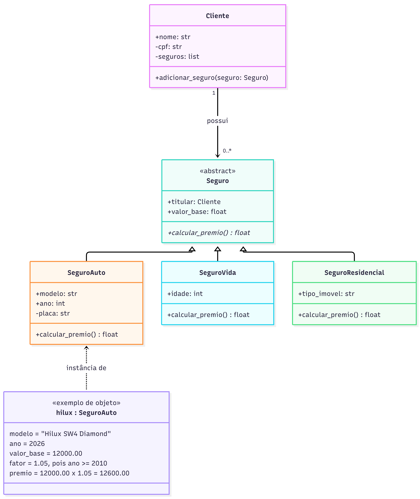
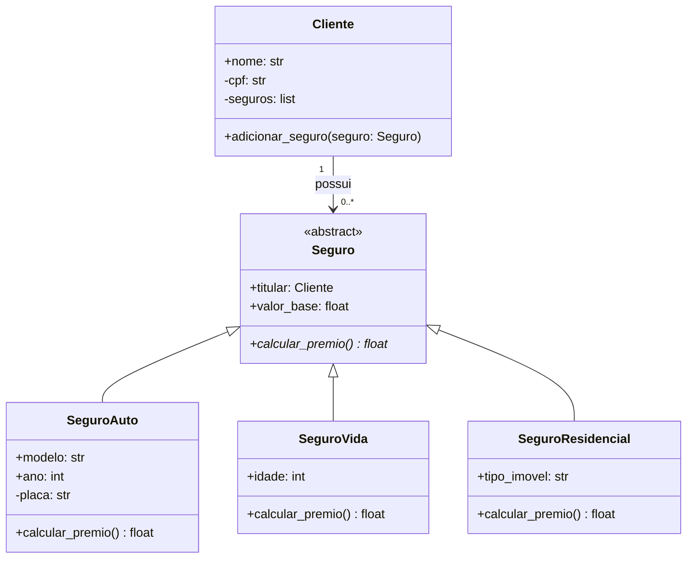

# Projeto 2 - Subsistema de Cálculo de Prêmios e Sinistros

**Aluno:** Daniel Almeida
**Disciplina:** Programação Orientada a Objetos

Este projeto substitui a função legada `calcular_valor_seguro`, baseada em
`if/else` e strings, por uma hierarquia de classes em que cada tipo de seguro
calcula o próprio prêmio.

## Estrutura de arquivos

```
PROJETO_2-Daniel_Almeida/
├── docs/
│   └── diagrama_classes.png   # Diagrama de classes UML
├── src/
│   ├── models/
│   │   ├── cliente.py         # Entidade Cliente
│   │   └── seguros.py         # Seguro (abstrata) e suas subclasses
│   └── main.py                # Demonstração do polimorfismo
├── tests/
│   └── test_seguros.py        # Testes automatizados
└── README.md
```

A entrega está em uma subpasta com o meu nome porque o `README.md` da pasta
`Projeto_2` é o enunciado do trabalho e não deve ser sobrescrito.

## O problema do código legado

```python
def calcular_valor_seguro(tipo, base, detalhe):
    if tipo == "CARRO":
        if detalhe < 2010:
            return base * 1.2
        return base * 1.05
    elif tipo == "VIDA":
        ...
```

Problemas identificados:

1. **Viola o princípio Aberto/Fechado:** para criar um seguro novo é preciso
   abrir e alterar a função que já funciona.
2. **Tipo identificado por string:** um erro de digitação como `"CARO"` não
   gera erro; a função apenas devolve o valor base, sem avisar.
3. **Parâmetro ambíguo:** `detalhe` significa ano, idade ou tipo de imóvel,
   dependendo do valor de `tipo`.
4. **Difícil de testar:** todas as regras estão misturadas em um único bloco.

## Como o polimorfismo resolveu

Cada regra foi movida para dentro da classe a que pertence. O programa
principal só percorre a lista e chama o mesmo método em todos os objetos:

```python
for seguro in seguros:
    print(f"{seguro}: R$ {seguro.calcular_premio():.2f}")
```

Não há nenhum `if/else` para descobrir o tipo: cada objeto responde a
`calcular_premio()` com a regra da sua classe.

### Correspondência entre o legado e as classes

| Legado (`tipo`) | Classe | Atributo que substituiu `detalhe` | Regra de cálculo |
| :-- | :-- | :-- | :-- |
| `"CARRO"` | `SeguroAuto` | `ano` | ano < 2010: base × 1.2; senão base × 1.05 |
| `"VIDA"` | `SeguroVida` | `idade` | idade > 60: base × 2.0; senão base × 1.1 |
| `"RESIDENCIAL"` | `SeguroResidencial` | `tipo_imovel` | casa: base × 1.15; senão base × 1.05 |

Os fatores são exatamente os do código legado; mudou apenas onde a regra mora.

## Conceitos de POO aplicados

| Conceito | Onde está | Como foi aplicado |
| :-- | :-- | :-- |
| Herança | `seguros.py` | `SeguroAuto`, `SeguroVida` e `SeguroResidencial` herdam de `Seguro`, que concentra `titular` e `valor_base`. As filhas só acrescentam o atributo e a regra específicos. |
| Abstração | `seguros.py` | `Seguro` herda de `ABC` e declara `calcular_premio()` com `@abstractmethod`, então não pode ser instanciada diretamente. |
| Polimorfismo | `main.py` | O laço chama `calcular_premio()` em uma lista com seguros de tipos diferentes, sem verificar o tipo de cada um. |
| Encapsulamento | `cliente.py` e `seguros.py` | O CPF (`__cpf`) e a placa (`__placa`) são atributos privados. O CPF só pode ser lido mascarado, pela propriedade `cpf`. |
| Associação | `cliente.py` e `seguros.py` | Um `Cliente` possui vários seguros. Ao ser criado, o seguro se registra no titular por `adicionar_seguro()`. |

## Diagrama de classes





- Seta de ponta vazia: herança das subclasses para `Seguro`.
- Seta simples com `1` e `0..*`: um cliente possui zero ou mais seguros.
- `+` indica atributo público e `-` indica atributo privado.
- A caixa `hilux : SeguroAuto` é um exemplo de objeto, não uma classe. Ela
  mostra o cálculo do prêmio para um veículo de 2026.

## Como executar

Requisito: Python 3. Dentro da pasta `PROJETO_2-Daniel_Almeida`:

```bash
cd Projeto_2/PROJETO_2-Daniel_Almeida
python src/main.py
```

### Saída obtida

```
SeguroAuto de Ana Souza: R$ 12600.00
SeguroAuto de João Lima: R$ 1200.00
SeguroVida de Ana Souza: R$ 2000.00
SeguroResidencial de João Lima: R$ 1150.00
Abstração funcionando: Can't instantiate abstract class Seguro without an implementation for abstract method 'calcular_premio'
```

### Conferência dos valores

| Seguro | Dados | Cálculo | Prêmio |
| :-- | :-- | :-- | :-- |
| Auto (Hilux SW4 Diamond) | base 12000, ano 2026 | 12000 × 1.05 | 12600.00 |
| Auto (Gol) | base 1000, ano 2008 | 1000 × 1.2 | 1200.00 |
| Vida | base 1000, 65 anos | 1000 × 2.0 | 2000.00 |
| Residencial | base 1000, casa | 1000 × 1.15 | 1150.00 |

A última linha da saída é o teste da abstração: o `main.py` tenta criar um
`Seguro` diretamente e o Python impede com `TypeError`.

Os clientes, placas e valores base são fictícios e servem apenas para
demonstrar o cálculo.

## Como adicionar um novo seguro

Para criar um "Seguro de Viagem", basta acrescentar uma classe em
`seguros.py`. Nenhuma classe existente e nenhum laço do `main.py` precisam
ser alterados:

```python
class SeguroViagem(Seguro):
    """Seguro de viagem: o prêmio depende do destino."""

    def __init__(self, titular, valor_base, internacional):
        super().__init__(titular, valor_base)
        self.internacional = internacional

    def calcular_premio(self):
        """Viagens internacionais pagam 30% a mais; nacionais, 10%."""
        if self.internacional:
            return self.valor_base * 1.3
        return self.valor_base * 1.1
```

Esta classe é apenas um exemplo de extensão e não faz parte da entrega.

## Testes automatizados

Os testes ficam em `tests/test_seguros.py` e verificam os casos de fronteira
de cada regra (ano 2009/2010, idade 60/61, casa/apartamento), a validação do
tipo de imóvel, a abstração de `Seguro`, a associação com o cliente e o CPF
mascarado.

Dentro da pasta `Projeto_2/PROJETO_2-Daniel_Almeida`:

```bash
python -m unittest discover -s tests -v
```

Resultado: 14 testes executados, todos aprovados.

## Validação de entrada

`SeguroResidencial` aceita apenas "CASA" ou "APARTAMENTO", sem diferenciar
maiúsculas e minúsculas. Qualquer outro valor gera `ValueError`, em vez de
receber silenciosamente a regra de apartamento. A validação acontece antes
de o seguro ser associado ao cliente, para que um seguro inválido não fique
registrado.

## Limite do encapsulamento

Os atributos com `__` (como `__cpf` e `__placa`) usam o mecanismo de
*name mangling* do Python: ficam escondidos do acesso direto, mas não são uma
proteção de segurança. Neste projeto servem para demonstrar o encapsulamento.
Em um sistema real, dados sensíveis também precisariam de criptografia no
armazenamento e controle de acesso.

## Decisões de projeto

- **`modelo` em `SeguroAuto`:** o legado só usava o ano; o modelo foi
  acrescentado para identificar o veículo no exemplo, sem alterar a regra.
- **`if` dentro de `calcular_premio()`:** esses `if` são regras de negócio
  (ano, idade, tipo de imóvel). O que foi eliminado é o `if/else` que
  verificava o tipo de seguro.
- **Lista de seguros somente leitura:** `Cliente.seguros` devolve uma tupla,
  para que a lista só seja alterada por `adicionar_seguro()`.